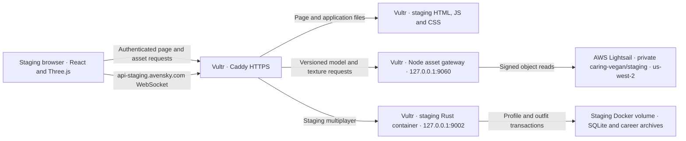

# Avensky scaling architecture

Avensky splits three kinds of work. The Rust game server handles live multiplayer. The staging asset gateway moves model bytes from private object storage. The browser decides which models to load and renders them on the player's device. Each part has a different performance budget and can be measured separately.

## Servers and request paths

The two Rust WebSocket services and the private staging asset gateway run on Vultr. The initial staging smoke test returned `206 Partial Content` and the four-byte `glTF` header for the narrow one-way road model through the loopback gateway. The owner confirmed the staging site loaded. The diagram shows the staging request paths, including the account storage path available when the account-capable Rust build is deployed.

| Component | Where it runs | Role |
| --- | --- | --- |
| Staging frontend | Browser and static files on Vultr | Caddy serves the built app behind staging access control. The browser loads the geometry and texture tiers selected for the current scene. |
| Staging asset gateway | Separate Node process on Vultr, loopback port 9060 | Matches each same-origin URL to a verified release, reads from Lightsail and streams bytes through to the browser. AWS credentials and signed URLs stay on the server. |
| Private model storage | AWS Lightsail Object Storage, `s3://caring-vegan/staging/`, `us-west-2` | Stores the heavy assets outside the Vultr filesystem. The release manifest determines which objects the gateway can serve. Staging access is limited to testers covered by the asset terms. |
| Staging multiplayer | Vultr, `api-staging.avensky.com`, host port 9002 | Runs the staging Rust container with a dedicated player-data volume and admission limits of six players and two active worlds. |
| Staging player database | Dedicated Docker volume on Vultr | Keeps one writer close to the Rust app and commits account, driver, and outfit changes without a separate database server. |
| Production multiplayer | Vultr, `api.avensky.com`, host port 9001 | Runs the live Rust container with its own persistent player data. Production keeps its existing frontend asset workflow. |
| Local development | Developer machine | Vite serves the app and local asset files. The development client uses a local Rust WebSocket by default. |

See the [environment configuration](DEPLOYMENT_ENVIRONMENTS.md), [staging Compose file](../compose.staging.yaml) and [private staging runbook](CLOUD_ASSETS.md).

## Build and delivery pipelines

GitHub Actions can build staging after merges to main and publish it after checking the private gateway. The manual live release uses the staged commit and its separately reviewed production bundle. Vultr switches the frontend root to a versioned directory after validation. [Frontend release and rollback runbook](FRONTEND_RELEASES.md)

1. **Author asset variants.** City tooling generates smaller textures and reduced geometry. Optional frontend scripts produce lighter character, wardrobe, Harbor and vehicle preview assets on a workstation with the approved inputs. These steps move generation work out of staging deployment. [City LOD tooling](../scripts/city-lod/README.md) · [Asset preparation](CLOUD_ASSETS.md#prebuilt-previews-and-generated-tiers)
2. **Compile with metadata.** Node 24 and Vite build the staging site from source, Git LFS pointers and prebuilt collider metadata. The build checks the collider lock against its source and output hashes and writes a manifest of expected model paths, sizes and digests. The public build directory contains zero GLBs. [Build configuration](../frontend/vite.config.ts) · [Collider verification](../frontend/scripts/prebuilt-colliders.mjs)
3. **Verify in CI and against storage.** GitHub Actions builds on Linux with LFS downloads disabled and checks the output. Before rollout, an operator verifies every manifest object against Lightsail. The verifier streams up to six objects at a time to check their SHA-256, sizes and relative GLB dependencies, then records their ETags. This reads the release over the network once per verification run and writes no model payloads to disk. [GitHub Actions workflow](../.github/workflows/cloud-assets.yml) · [Object verification](../deploy/staging-assets/verify-release.mjs)
4. **Deliver the requested tier.** The browser requests `/__staging-assets/<release-id>/<asset-path>`. Caddy gates access and forwards the request to the gateway. The gateway pins the read to the verified ETag, supports single byte ranges and gives authorized browsers a private cache entry. A release ID change gives the new release fresh URLs. [Browser URL resolver](../frontend/src/assets/assetPaths.ts) · [Streaming gateway](../deploy/staging-assets/gateway.mjs)

## Where performance can improve

| Mechanism | Work it reduces | What to measure |
| --- | --- | --- |
| Pointer-only deploy | Model bytes fetched during checkout and stored on the build host | Deployment time, checkout bytes and disk usage |
| City chunks and levels of detail (LODs) | Geometry and textures loaded and drawn as the camera moves. Fast and Balanced use 512 px and 1024 px texture variants for authored city templates. | Bytes transferred, draw calls, triangles and frame times on a fixed drive route |
| Fleet LOD queue | Duplicate and simultaneous model requests. The fleet loader coalesces requests, permits two active loads and uses already available models or compact seed geometry while a tier loads. | Requests in flight and time to visible vehicles |
| Prebuilt previews and browser workers | Preview geometry to decode, and main-thread work when the portrait runs in an offscreen worker | Time to first visible preview and main-thread stalls |
| Versioned browser cache | Model bytes fetched again on repeat visits to the same release | Cold versus warm model bytes and time to the first usable scene |
| Menu background | Replaces two bundled videos (75.2 MB combined) with a 47 kB muted main-menu loop and a 10.5 kB WebP fallback used by reduced-motion and loading screens | Cold menu bytes and time until the first button responds |
| Embedded player database | Avoids a database network hop while the staging game runs as one writer | Account response time, SQLite commit time, and volume growth independently of simulation frame time |

Implementation references include [city tier selection](../frontend/src/world/cityLod.ts), [fleet loading](../frontend/src/vehicles/fleetAssets.ts) and the [portrait worker](../frontend/src/game/characters/characterPortrait.worker.ts).

Account hashing and database writes run off the simulation path. Track write latency and lock contention as player traffic grows. Revisit a separate database when several game processes need shared writes or availability across hosts. The current staging database uses the existing Vultr volume. [Onboarding and database rollout](PLAYER_ONBOARDING.md) · [SQLite deployment tradeoffs](https://www.sqlite.org/whentouse.html)

## A first scaling experiment

Run the same garage-to-city route with a cold browser cache, then repeat it with a warm cache on the same browser and device. Keep the build, map and quality settings fixed. Record time to first usable scene, model bytes transferred, frame time and the staging WebSocket connection time. For a second comparison, reset the cache and repeat with Original and Fast quality. Track which requests change along with the frame times so a smaller download and a faster frame are measured independently.

The staging build completes with LFS pointers. The verified staging manifest `0ce3600db01f00ee84805662ab8fd5f7679b4ad79dbd1dac0410b45c7212bc4e` describes about 2.18 GiB of assets, all kept out of the deploy directory. The gateway carries model traffic through Vultr on browser cache misses, so watch its outbound bandwidth, upstream response latency and error rate separately from Rust CPU and WebSocket latency. Compare cold and warm browser performance on actual staging devices to quantify the effect.
