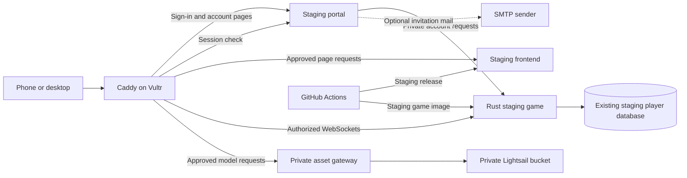

# One sign-in for Avensky staging

The staging game account owns the password and player data. The portal stores invite access, optional authenticators, and website sessions attached to game profile IDs. The same game profile keeps its character names, equipped outfits, achievements, and world saves. The unified mode replaces the shared browser password prompt and the separate portal password together.

## How the services fit together



The portal renders sign-in and invitation pages on loopback port 9061. It calls an authenticated game account bridge on the staging Rust port, 9002. Rust keeps sole access to its player database. Caddy checks an HTTPS session cookie before serving the app and model requests. For the same-origin WebSocket, Caddy asks the internal verifier on loopback port 9062 for a short-lived signed admission. Rust validates it and binds that connection to the existing profile. Guest enrollment can upgrade the staging profile stored in the original browser.

With the staging gate enabled, Rust requires an admission for all game sockets, including the old API hostname. The deployment probe can still complete a loopback WebSocket upgrade. Without an admission that socket closes before registering a client. A device-only game token issued before cutover can be redeemed on an invite to preserve the guest's saves.

## Invite and existing account behavior

- A manager issues an expiring, single-use invite. Send its link privately or use an optional email relay. The invite approves the intended account for staging.
- An existing player signs in with their game credentials and redeems the invite. Preserve the game's profile ID and saves. A legacy username can be linked to the invited email after the player proves access to the existing account.
- For a saved guest profile, open the invite in that browser and choose **Keep this browser’s guest profile**. The game upgrades the existing profile with the invited email and new password.
- A new player redeems the invite once and creates a game account and character. After signing in, returning players go straight to character selection.
- The staging signup path requires an invite. Revoking alpha access blocks new sessions and private model requests and disconnects the active game session. The player profile and saves are retained.

The unified portal stores admissions in `/var/lib/avensky-alpha/game-access.sqlite3`. The previous preview database is available for rollback. Issue fresh invites so existing players can prove ownership using game credentials or a saved guest profile. The old portal password has no role in linking an existing game identity.

## Vultr cutover

Publish the release with the staging game enabled first. The new build supports the existing staging routes until the game key and unified Caddy routes are enabled. This rollout uses the existing staging game volume and the existing asset release. Protect ports 9002, 9061, and 9062 at loopback.

1. From the published commit, install `accounts.mjs`, `game-bridge.mjs`, and `portal.mjs` from `deploy/staging-access/` into `/usr/local/lib/avensky/staging-access/`. Keep a copy of the prior portal modules and both existing service configurations. Use Node 24.
2. Set the same new, random 64-hex-character secret as `AVENSKY_ALPHA_GAME_KEY` in `/etc/avensky/staging-alpha.env` and `AVENLAB_STAGING_SIGN_IN_KEY` in the staging game's environment. Keep the existing `AVENSKY_ALPHA_KEY`. Store both files as root with mode 0600. An `env_file` under the staging Compose game's service can load a root-owned file. Leave `AVENLAB_ENV=staging` and the named staging volume in place.
3. Recreate just the staging game with its current reviewed image and the updated operator-managed Compose file, then restart `avensky-alpha-access`. Before changing Caddy, issue an admin invite. Under the existing staging guard, enroll with a known game account and open `/__alpha/account` on the same tab. Verify the administrator can create a second manual invite.
4. Merge the handlers in [staging-unified.Caddyfile](../deploy/staging-access/staging-unified.Caddyfile) into the `staging.avensky.com` site and remove its shared Basic Auth. Preserve the actual staging release root and other host blocks. The public portal goes to 9061 and the WebSocket auth preflight goes to 9062. Never reverse-proxy the 9062 listener as a browser endpoint. Validate the full Caddyfile and reload Caddy.
5. In a fresh mobile browser session, confirm the website goes to the ordinary sign-in form, an uninvited user cannot join, and an approved player sees the saved characters and outfits after one sign-in. Verify anonymous model and socket requests return 401, an approved model request returns 206 for a byte range, and revocation disconnects a tester. Check 2FA and reconnect with a saved profile.

On the host with the existing release helper, the following root commands prepare the currently published staging revision. First confirm `publish-staging` reported success for both the game and frontend.

```bash
(
  set -euo pipefail
  umask 077
  alpha_backup="/root/avensky-before-unified-$(date +%Y%m%d-%H%M%S)"
  alpha_dir=/usr/local/lib/avensky/staging-access
  alpha_source=/var/lib/avensky-staging-deploy/source.git
  alpha_web=$(readlink -f /srv/avensky-staging/frontend/current)
  alpha_commit=$(basename "$(dirname "$alpha_web")")
  install -d -m 0700 "$alpha_backup"
  cp -a "$alpha_dir" /etc/avensky/staging-alpha.env \
    /etc/avensky/staging-game.compose.yaml /etc/caddy/Caddyfile "$alpha_backup/"
  for file in accounts.mjs game-bridge.mjs portal.mjs staging-unified.Caddyfile; do
    git --git-dir="$alpha_source" show "$alpha_commit:deploy/staging-access/$file" > "$alpha_backup/$file"
  done
  /usr/bin/node --check "$alpha_backup/accounts.mjs"
  /usr/bin/node --check "$alpha_backup/game-bridge.mjs"
  /usr/bin/node --check "$alpha_backup/portal.mjs"
  install -m 0644 "$alpha_backup"/{accounts.mjs,game-bridge.mjs,portal.mjs,staging-unified.Caddyfile} "$alpha_dir/"
  if ! grep -q '^AVENSKY_ALPHA_GAME_KEY=' /etc/avensky/staging-alpha.env; then
    alpha_key=$(openssl rand -hex 32)
    printf 'AVENSKY_ALPHA_GAME_KEY=%s\n' "$alpha_key" >> /etc/avensky/staging-alpha.env
    chmod 0600 /etc/avensky/staging-alpha.env
    printf 'AVENLAB_STAGING_SIGN_IN_KEY=%s\n' "$alpha_key" > /etc/avensky/staging-unified-game.env
  fi
  test -s /etc/avensky/staging-unified-game.env
  printf 'Previous configs and modules saved in %s\n' "$alpha_backup"
)
```

In `/etc/avensky/staging-game.compose.yaml`, add the following under `services.game`. If that service already has an `env_file` list, append this entry.

```yaml
    env_file:
      - /etc/avensky/staging-unified-game.env
```

Keep the staging game on its deployed release image while applying the environment change. This restarts the staging player session once.

```bash
(
  set -euo pipefail
  alpha_compose=/etc/avensky/staging-game.compose.yaml
  stage_game=$(docker compose -p avensky-staging -f "$alpha_compose" ps -q game)
  [ -n "$stage_game" ]
  stage_image=$(docker inspect --format '{{.Config.Image}}' "$stage_game")
  [[ "$stage_image" == avensky-staging-game:* ]]
  docker compose -p avensky-staging -f "$alpha_compose" config --quiet
  printf 'services:\n  game:\n    image: "%s"\n' "$stage_image" |
    docker compose -p avensky-staging -f "$alpha_compose" -f - up -d --no-deps --no-build --pull never --force-recreate game
  systemctl restart avensky-alpha-access
)
```

Create the first administrator as the server operator using the same command as in the preview. It creates an invite for the unified store when the portal game key is configured.

```sh
read -r -p 'Alpha administrator email: ' alpha_admin
systemd-run --wait --pipe --quiet --uid=avensky-alpha \
  -p EnvironmentFile=/etc/avensky/staging-alpha.env \
  --setenv=AVENSKY_ALPHA_STATE=/var/lib/avensky-alpha \
  /usr/bin/node /usr/local/lib/avensky/staging-access/portal.mjs invite-admin "$alpha_admin"
```

To roll back, restore the previous staging Caddy and service configurations, recreate only the staging game using the previous configuration, and restart the portal. The new admissions database can be kept for a later retry. The game database is shared across staging releases as before.

## Mail is independent

Manual invite links are sufficient for a small alpha. SMTP can be added later for delivery of invites and reset links. Vultr blocks outbound TCP 25 by default, so a direct-delivery Postfix server would need an unblock and compatible sending DNS and authentication. A local mail submission service can also hand off to an authenticated relay on port 587. [Vultr SMTP limits](https://docs.vultr.com/support/products/compute/why-is-smtp-blocked) · [Postfix direct and relay delivery](https://www.postfix.org/BASIC_CONFIGURATION_README.html#relayhost) · [Gmail sender requirements](https://support.google.com/a/answer/81126)

