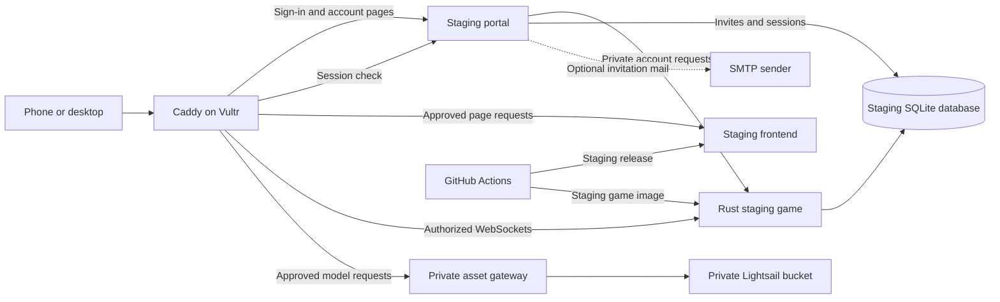

# One sign-in for Avensky staging

At `/sign-in`, a tester uses the approved email and game password. The existing staging game database stores the player account, characters, alpha invitations, optional authenticators and browser sessions in one physical SQLite file. The same game profile keeps its character names, equipped outfits, achievements, and world saves. The unified mode replaces the shared browser password prompt and the separate portal password together.

## How the services fit together



The portal renders sign-in and invitation pages on loopback port 9061. It calls an authenticated game account bridge on the staging Rust port, 9002. Rust owns player records and verifies game passwords. The portal uses separate access tables in the same database. Caddy checks an HTTPS session cookie before serving the app and model requests. The staging app connects directly to `wss://staging.avensky.com/ws/` on startup and reconnect, so the browser can send that same cookie. Caddy asks the internal verifier on loopback port 9062 for a short-lived signed admission. Rust validates it and binds that connection to the existing profile. Guest enrollment can upgrade the staging profile stored in the original browser.

With the staging gate enabled, Rust requires an admission for all game sockets, including the old API hostname. The deployment probe can still complete a loopback WebSocket upgrade. Without an admission that socket closes before registering a client. A device-only game token issued before cutover can be redeemed on an invite to preserve the guest's saves.

## Invite and existing account behavior

- A manager issues an expiring, single-use invite and sends its link privately. The invite approves the intended account for staging.
- Each player accepts the invite using their email and one password. A new email creates a game account. Use the existing game password if the email already has an account to keep its profile and saves. Returning players go straight to character selection.
- Sign-in starts with email and password. A password visibility button lets players check their typing on mobile. Accounts with two-factor authentication enabled receive a separate authenticator or recovery-code prompt after their password is verified. The prompt expires after five minutes. Staging currently uses authenticator apps and one-use recovery codes for 2FA.
- Open the invite in the original browser to retain a saved guest profile. The invite can upgrade an available guest profile to the invited email.
- An operator can preserve a legacy username by specifying it in **Alpha testers** when creating the invite or by passing `--game-login EXISTING_USERNAME` to `invite-admin`. The tester still enters only their email and game password.
- The staging signup path requires an invite. Revoking alpha access blocks new sessions and private model requests and disconnects the active game session. The player profile and saves are retained.

The portal unit binds the named game volume’s staging directory into its private mount namespace. Its `/run/avensky-player/social.sqlite3` and the Rust game’s `/data/staging/social.sqlite3` are the same file. An old `/__alpha/sign-in` bookmark redirects to `/sign-in`. Returning signed-in players continue to character selection. A portal session created when the player accepts an invite also authenticates their game connection. The portal serves the lightweight 3D room, its wall finish, cached first frames, login styling and optional Xbox input module from the published frontend. The room renders when its size or colors change. Heroes can use the GPU as soon as it needs its larger scene. The app, models, and multiplayer endpoint use the same invite gate.

## Vultr cutover

For the existing staging installation, run this as root on Vultr after the frontend publisher reports success for the change. The installer reads the revision the staging frontend actually serves. It backs up the database, imports the previous unified access records, updates the portal and Caddy, and verifies the public garage page. The game can stay online. The host must already have its staging bridge key, the managed `avensky-alpha-access` unit, and the local `avensky-staging_avensky_staging_data` volume.

```bash
set -e
revision=$(basename "$(dirname "$(readlink -e /srv/avensky-staging/frontend/current)")")
script=$(mktemp)
git --git-dir=/var/lib/avensky-staging-deploy/source.git show "$revision:deploy/staging-access/install-sign-in.sh" > "$script"
bash "$script"
rm -f "$script"
```

For a sign-in UI update after cutover, run the same commands with `bash "$script" --ui-only`. This refreshes the portal and its theme files from the active release, restarts the portal, and checks its sign-in page and controller assets.

If the journal reports `217/USER` for UID 10001, retry the normal installer from the published release. Before stopping the old portal, it provisions the host login-disabled service account `avensky-staging` with UID and GID 10001 on hosts that need it. It checks for identity conflicts and verifies that systemd can open the game database as the service user. Hosts already configured to run the portal as the game database owner retain their existing identity. A failure at systemd's USER step happens before the access migration runs.

Use `bash "$script" --fresh` for a first cutover with an empty invitation list. Existing game accounts and saved characters survive either choice. A successful migration records its version inside the game database, so repeating the installer preserves subsequent invites and revocations. The old access file remains an offline backup. A legacy portal with its own password hashes requires fresh email invitations. The installer refuses to copy its password hashes.

The default installer handles a standalone staging site in `/etc/caddy/Caddyfile`. For a host using imported Caddy fragments, route the exact `/sign-in` path to the same loopback portal as `/__alpha/*` using the staging template. Preserve the private socket verifier and asset gate. Install the service, database migration and staging release helper together before enabling the new route. On future game releases the helper pauses both database users before taking or restoring its cold snapshot. Frontend-only releases keep both processes running.

For a first-time host, configure `AVENLAB_ENV=staging`, the existing named game volume, and matching 64-hex staging bridge keys in the game (`AVENLAB_STAGING_SIGN_IN_KEY`) and portal (`AVENSKY_ALPHA_GAME_KEY`). Keep `AVENSKY_ALPHA_KEY` stable for encrypted two-factor data and use Node 24. The game initializes its own player database first. Follow the unit and Caddy templates under `deploy/staging-access/` for an initial installation. Bind the public portal to loopback 9061 and its internal socket verifier to loopback 9062.

## Operator invitations and password recovery

The game account owns the password. A manager can issue a tester invite from the signed-in character Profile tab. For the first admin or a password reset, use this shell function as the staging operator. It runs with the same UID, database path and encryption settings as the running service.

```bash
staging_account() {
  systemd-run --wait --pipe --quiet --collect --uid=10001 --gid=10001 \
    -p UMask=0077 -p EnvironmentFile=/etc/avensky/staging-alpha.env \
    -p BindPaths=/var/lib/docker/volumes/avensky-staging_avensky_staging_data/_data/staging:/run/avensky-player \
    --setenv=AVENSKY_GAME_DATABASE=/run/avensky-player/social.sqlite3 \
    /usr/bin/node /usr/local/lib/avensky/staging-access/portal.mjs "$@"
}
```

Use `staging_account invite-admin EMAIL` to obtain the first private admin invitation. Use `staging_account reset-password EMAIL` after verifying a tester's identity. Send the resulting one-use URL privately. A reset link expires after 30 minutes and a successful reset ends old sessions. Pending, expired and revoked alpha access still requires a valid invitation. For a legacy game login, use the existing `--game-login LOGIN` invitation option.

## Mail is independent

Manual invite links are sufficient for a small alpha. SMTP can be added later for delivery of invites and reset links. Vultr blocks outbound TCP 25 by default, so a direct-delivery Postfix server would need an unblock and compatible sending DNS and authentication. A local mail submission service can also hand off to an authenticated relay on port 587. [Vultr SMTP limits](https://docs.vultr.com/support/products/compute/why-is-smtp-blocked) · [Postfix direct and relay delivery](https://www.postfix.org/BASIC_CONFIGURATION_README.html#relayhost) · [Gmail sender requirements](https://support.google.com/a/answer/81126)

